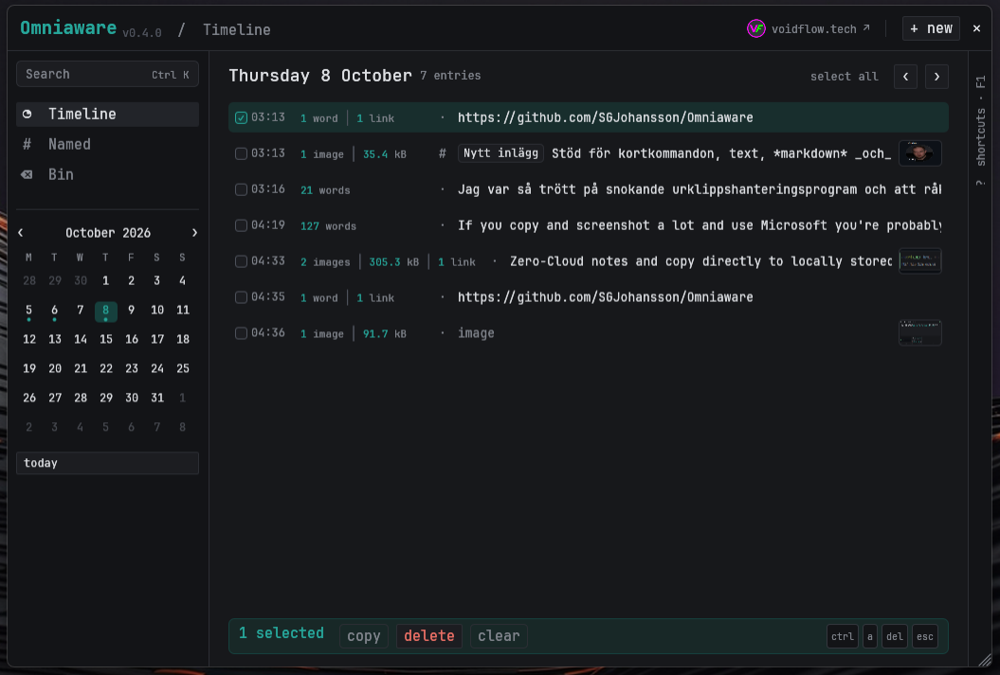
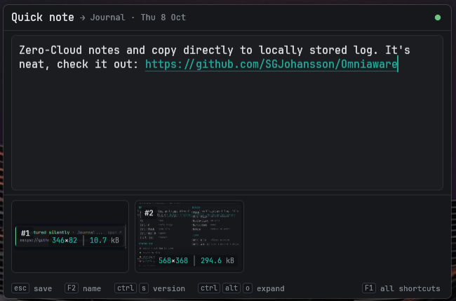
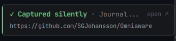

# Omniaware

A lightweight, keyboard-first home for everything I don't want to lose: clipboard snippets, quick notes, links, screenshots and journal entries — captured in a keystroke and laid out on a timeline.

I built Omniaware to replace a patchwork of AutoHotkey pop-ups, a separate Markdown editor and browser-based note tools. The goals are simple: it should be there the instant I need it, stay out of the way when I don't, and never lose a single character — not even on a power cut.

> **Status:** early development (v0.8). Windows 10/11 only. The interface is in British English.
>
> **Forgot a shortcut?** Press `F1` anywhere in Omniaware for the full list, or see [Keyboard shortcuts](#keyboard-shortcuts).



## Features

<p align="center">
  
  &nbsp;
  
</p>
<p align="center"><sub>The capture popup (<code>Ctrl+Alt+O</code>) and the notice after a silent capture (<code>Ctrl+C</code> <code>C</code>).</sub></p>

- **Silent capture** — press `Ctrl+C` twice in quick succession and the clipboard (text or image) is saved straight to today's journal. The tray icon briefly turns green; nothing else interrupts you.
- **One key for everything else** — `Ctrl+Alt+O` opens a small capture window pre-filled with the clipboard. Press it again and the same note expands into the main window: a day-by-day timeline, a month calendar marking days with content, named entries and a recycle bin. Press it a third time to put everything away.
- **Screenshots** — `Ctrl+Alt+S` freezes every screen under a dimmed overlay, much like `Win+Shift+S`: drag an area, click a window, click the desktop (or press `Enter`) for the whole screen, `Esc` or a right-click to cancel. `Ctrl+Alt+Shift+S` takes the screen under the pointer at once, with nothing shown. Each shot lands in today's journal, on the clipboard and in `Pictures\OA Screenshots` as `OA 2026-10-12 14.32.07.png`, followed by the usual notice. The overlay never takes focus, so a game in borderless full screen is neither minimised nor interrupted; for games with mouselook, use `Ctrl+Alt+Shift+S`.
- **Search** — `Ctrl+K` searches everything. Words match anywhere inside words (`affe` finds *Kaffekannor*), `*` and `?` are wildcards, and `/…/` takes a full regular expression. Each hit shows the matching line with the match highlighted; `Shift+Enter` pastes the result straight into the window you came from.
- **Tidy up in bulk** — every list supports `Ctrl`+click, `Shift`+click and `Ctrl+Shift`+click selection, `Ctrl+A` selects the whole list on screen, and `Delete` moves the selection to the bin. The bin can restore, delete forever or be emptied.
- **A word when it's saved** — closing a note or capturing silently shows a small notice above the system tray (what was saved, where, and how much). Click it to open the entry; hover to keep it.
- **Markdown and links** — entries are plain Markdown. The editor highlights headings, **bold**, *italics*, `code`, lists, task boxes and quotes as you type, and every web, FTP, file or `mailto:` address becomes a link (`Ctrl`+click to open). `Ctrl+E` shows the rendered preview.
- **Images** — pasted images are kept as attachments shown above the text; an image-only entry is displayed full size with the text as its caption. Every image is numbered and shows its dimensions and file size; hover for the full details. Pasting a picture that is already attached asks before adding it as a copy (the file is shared, not duplicated). Click to select (`Ctrl`+click for several, `Delete` removes), double-click to enlarge, right-click to copy, save, open with another program or show the file in Explorer.
- **Save as a file** — `Ctrl+Shift+S` (or *save as…*) writes the entry's text to any file: a script here, a note there. Usually faster than opening an editor. The entry stays in the journal, and the next save as starts from the same file. Files are written as UTF-8 with Windows line endings; shell scripts (`.sh`, `.bash`, `.zsh`, `.fish`) get Unix line endings and PowerShell files (`.ps1`, `.psm1`, `.psd1`) a byte-order mark so Windows PowerShell 5.1 reads `åäö` correctly.
- **Send to a shell, never run** — `Ctrl+Enter` hands the note to the shell it looks like (the suggestion shows in the footer: `→ PowerShell`, `→ WSL`, `→ cmd`, `→ Explorer`); `Ctrl+Shift+Enter` lets you choose. Each opens in its own console window with the text **on the prompt line, unrun** — read it, edit it, press Enter yourself:
  - *PowerShell* (pwsh, else Windows PowerShell): inserted through PSReadLine; several lines stay one editable block.
  - *WSL* (your default distribution): one line on an editable prompt line; several lines are printed and the prompt line sources them.
  - *cmd*: typed at the prompt; several lines become `call "<file>"`.
  - *Explorer*: opens a path (`C:\…`, `\\server\share`, `/mnt/c/…`, Linux paths through WSL) with the file selected, or a web address in the browser.
  - *Previous window*: pastes with `Ctrl+V` (several lines are flagged: a terminal may run each one).

  It asks first, with *as administrator* (one UAC prompt) and *don't ask again* per target. Shells start in your home folder unless `[send] cwd` says otherwise.
- **Export several at once** — select entries in any list and press `Ctrl+Shift+S` (or *export…*). One entry is written exactly as it is; several become one plain-text file, oldest first, each under a one-line header with its date, name and image count. Images are attachments, so the text is clean.
- **Named snippets** — give an entry a name (`F2`) and it becomes a reusable snippet, much like an AutoHotkey text store. `Enter` or `Tab` takes you straight back to the text.
- **At a glance** — the timeline shows each entry's word count, number of images, size on disk and links next to the time.
- **Themes** — dark, light, system (follows Windows, switching live) and VoidFlow, after [voidflow.tech](https://voidflow.tech/): near-black panels, phosphor-green text and a crimson edge, with optional scanlines. `Ctrl+Shift+T` or the theme button in the main window cycles through them; the choice is remembered.
- **Crash-safe by design** — see [Data and durability](#data-and-durability).

## Keyboard shortcuts

Everything below is also in the app: press **`F1`** in the capture popup (hold or click) or in the main window (toggles a side panel). The global keys at the top are read from `config.toml`, so if you change one, `F1` shows your key.

**Global** — work anywhere in Windows

| Shortcut | Action |
|---|---|
| `Ctrl+C` `C` | Save the clipboard silently (hold `Ctrl`, tap `C` twice) |
| `Ctrl+Alt+O` (or `AltGr+O`) | 1st press: quick note · 2nd: expand to the main window · 3rd: close |
| `Ctrl+Alt+S` | Screenshot: area, window or whole screen (see below) |
| `Ctrl+Alt+Shift+S` | Screenshot of the screen under the pointer, at once, nothing shown |
| Tray icon click | Quick note |
| Tray icon right-click | Menu: quick note, open Omniaware, screenshot, quit |
| Click a notice | Open what was just saved (hover keeps the notice) |

**Screenshot overlay** (`Ctrl+Alt+S`)

| Shortcut | Action |
|---|---|
| Drag | Take an area |
| Click | Take the window under the pointer |
| Click on the desktop | Take that whole screen |
| `Enter` | Take the screen under the pointer |
| `Esc` or right-click | Cancel |

Every shot goes to today's journal, the clipboard and `Pictures\OA Screenshots`. The game or app in front keeps focus throughout.

**Quick note** (the capture popup)

| Shortcut | Action |
|---|---|
| `Esc` | Save and close (an empty note saves nothing) |
| `Shift+Esc` | Discard (moves it to the bin) |
| `Ctrl+S` | Save a version now |
| `Ctrl+Shift+S` | Save the text as a file |
| `Ctrl+V` | Paste text or an image |
| `Ctrl`+click | Open a link |
| `Ctrl+Alt+O` | Keep the note and expand to the main window |
| `F1` (hold or click) | All shortcuts; the most common ones are always listed along the bottom |

**Naming** (quick note and main window)

| Shortcut | Action |
|---|---|
| `F2` | Name the entry; a named entry is a reusable snippet |
| `Enter` / `Tab` | Keep the name and go back to the text (a click elsewhere does the same) |
| `Ctrl+Enter` | Keep the name and close (quick note) |
| `Esc` | Cancel naming (quick note) |

If the name is already taken, press `Enter` again to move it here; the other entry keeps its text, unnamed.

**Send to a shell** (quick note and an open entry)

| Shortcut | Action |
|---|---|
| `Ctrl+Enter` | Send to the suggestion shown in the footer (`→ PowerShell`, `→ WSL`, …) |
| `Ctrl+Shift+Enter` | Choose where to send |
| `1`–`5` | Pick and send: PowerShell, WSL, cmd, Explorer, previous window |
| `↑` `↓` · `Enter` | Move · send |
| `A` | As administrator (one UAC prompt) |
| `D` | Don't ask again for this target |
| `Esc` | Cancel |

**Main window**

| Shortcut | Action |
|---|---|
| `←` `→` / `T` | Previous / next day / today |
| Click a day in the calendar | Go to that day |
| `Ctrl+N` | New entry |
| `Ctrl+K` | Search |
| `Ctrl+S` | Save a version of the open entry now |
| `Ctrl+Shift+S` | Save the open entry as a file |
| `Ctrl+E` | Edit / preview |
| `Ctrl+V` · `Ctrl`+click | Paste text or an image · open a link |
| `F1` | Show or hide the shortcut panel |
| `Ctrl+Shift+T` | Next theme: dark → light → system → voidflow (also in the quick note) |
| `Esc` | Back; on the timeline, close the window |

**Lists** (timeline, named, bin, search results)

| Shortcut | Action |
|---|---|
| Click | Open |
| `Ctrl`+click / `Shift`+click | Select an entry / a range |
| `Ctrl+Shift`+click | Add a range |
| `Ctrl+A` | Select the whole list on screen |
| `Ctrl+Shift+S` | Export the selection as one plain-text file |
| `Delete` | Move to the bin; in the bin, delete forever (press twice) |
| `Esc` | Clear the selection |

**Search** (`Ctrl+K`)

| Shortcut | Action |
|---|---|
| `↑` `↓` | Select a result |
| `Enter` | Open |
| `Shift+Enter` | Paste into the window you came from |

Words match anywhere inside words (`affe` finds *Kaffekannor*), `*` and `?` are wildcards, and `/…/` is a full regular expression.

**Images** (in any entry)

| Shortcut | Action |
|---|---|
| Click / `Ctrl`+click | Select / select several |
| Double-click | Enlarge |
| Right-click | Copy, save as, open with, show in folder, remove |
| `Delete` | Remove the selected |
| `Esc` | Deselect, or close the enlarged view |

## Installation

### Download

Pre-built binaries are published on the [Releases](https://github.com/SGJohansson/Omniaware/releases) page. Download `omniaware.exe` and run it — no installer, no dependencies. To start it with Windows, place a shortcut in `shell:startup`.

### Build from source

Requires the Rust toolchain and the MSVC build tools:

```powershell
winget install Rustlang.Rustup
winget install Microsoft.VisualStudio.2022.BuildTools --override "--quiet --add Microsoft.VisualStudio.Workload.VCTools --includeRecommended"

git clone https://github.com/SGJohansson/Omniaware.git
cd Omniaware
cargo build --release
.\target\release\omniaware.exe
```

To build and install in one step (to `%LOCALAPPDATA%\Programs\Omniaware`, with a Start menu shortcut):

```powershell
powershell -ExecutionPolicy Bypass -File scripts\install.ps1            # add -Startup to start with Windows
```

Run it again after pulling a new version; it closes the running copy, replaces it and starts the new one. Your data is not touched.

### Measuring resource use

Omniaware is meant to sit in the background all day, so what it costs there is measured rather than guessed. Every CI build has an `omniaware-bench-kit` artifact: `omniaware.exe`, `oa-probe.exe` and a short guide. Unzip it on any Windows machine and run `oa-probe.exe`; it starts a separate benchmark copy of Omniaware (its own data, no global shortcuts, no clipboard writes, so a real copy keeps running) and records CPU, memory, GPU memory, handles and threads for up to 72 hours, alternating the `wgpu` and `glow` renderers. Results, including a description of the machine, are written next to the probe in `bench\<COMPUTERNAME>\`.

## Data and durability

Everything lives locally in `%APPDATA%\Omniaware\` (override with the `OMNIAWARE_DATA` environment variable). Nothing is sent anywhere.

| File | Contents |
|---|---|
| `omniaware.db` | All entries, revision history and the search index (SQLite) |
| `blobs\` | Images, stored content-addressed by their BLAKE3 hash |
| `send\` | Text handed to shells (cleared after a day) |
| `config.toml` | Settings; created with defaults on first start |
| `omniaware.log` | Errors, plus notes on slow window opens and ignored shortcut presses |

How it avoids losing data:

- The clipboard is written to the database **before** the capture window is even shown.
- Edits are saved 300 ms after the last keystroke (a short pulse on the status dot), in SQLite WAL mode with `synchronous=FULL` (every commit is flushed to disk).
- A revision snapshot is kept each time an entry is closed.
- Images are written to a temporary file, flushed and then atomically renamed.
- Deleting moves entries to a recycle bin; permanent removal requires a second confirmation.

## Configuration

```toml
renderer = "wgpu"            # "glow" switches to OpenGL if the GPU driver misbehaves
theme = "dark"               # "light", "system" (follows Windows) or "voidflow"
scanlines = false            # faint CRT scanlines over the VoidFlow theme

[hotkeys]
capture = "ctrl+alt+KeyO"    # modifiers: ctrl / alt / shift / super
main = ""                    # optional direct shortcut to the main window
screenshot = "ctrl+alt+KeyS"            # "" turns a shortcut off
screenshot_full = "ctrl+alt+shift+KeyS"

[window]
width = 640.0                # capture popup
height = 420.0
font_size = 14.0
main_width = 1040.0
main_height = 700.0

[send]
cwd = ""                     # folder shells start in; "" = your home folder
pwsh = ""                    # "" = pwsh.exe if installed, else Windows PowerShell
skip_confirm = []            # targets that no longer ask: "pwsh", "cmd", "wsl", "explorer", "window"
```

## Roadmap

- Arrows, boxes and highlights on screenshots
- Events with natural-language dates in Swedish (`imorgon 14 tandläkare`), a full calendar view and reminders
- Desktop post-it notes
- An aggregated to-do view built from Markdown task lists
- Optional encrypted backup to a self-hosted server

## Built with

[Rust](https://www.rust-lang.org/), [egui](https://github.com/emilk/egui), [SQLite](https://sqlite.org/) via rusqlite, and the [JetBrains Mono](https://www.jetbrains.com/lp/mono/) typeface.

## Author

Made by S.G. Johansson — [voidflow.tech](https://voidflow.tech/).

## License

Omniaware is released under the [MIT License](LICENSE). JetBrains Mono is bundled under the [SIL Open Font License 1.1](assets/fonts/LICENSE-JetBrainsMono.txt).
